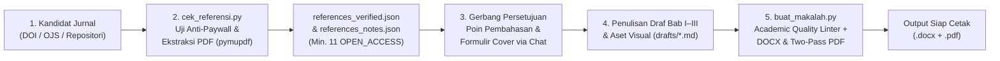
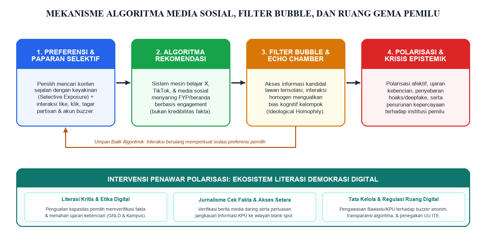

<div align="center">

# Makalah Generator (`penyusun-makalah`)

**Agent Skill & Kompilator Makalah Akademik Standar Perguruan Tinggi (DOCX & PDF)**

[](https://www.python.org/)
[-1E3A8A?style=for-the-badge)](#fitur-utama)
[](#fitur-utama)
[](#instalasi--penggunaan-cli)

<p align="center">
  <a href="#fitur-utama">Fitur Utama</a> •
  <a href="#arsitektur-alur-kerja">Arsitektur</a> •
  <a href="#pratinjau-output-visual">Pratinjau Visual</a> •
  <a href="#contoh-makalah-demo">Contoh Makalah</a> •
  <a href="#instalasi--penggunaan-cli">Instalasi & CLI</a> •
  <a href="#struktur-repositori">Struktur Proyek</a>
</p>

</div>

---

**Makalah Generator (`penyusun-makalah`)** adalah *Agent Skill* sekaligus kompilator dokumen ilmiah berbasis Python yang mengotomatiskan seluruh siklus penyusunan makalah akademik—mulai dari uji keterbukaan jurnal bebas *paywall*, ekstraksi teks penuh PDF via `pymupdf`, penyusunan draf berbasis fakta empiris, audit kualitas dua arah (*Academic Quality Linter*), hingga kompilasi serentak ke **Microsoft Word (`.docx` dengan Native TOC)** dan **PDF siap cetak (Two-Pass Dotted TOC)** sesuai standar perguruan tinggi Indonesia.

> **Catatan Privasi Demo:** Seluruh data identitas mahasiswa, dosen pengampu, program studi, dan perguruan tinggi pada folder contoh (`makalah_workspace/`) menggunakan **nama samaran (*dummy/demo*)** dan logo generik untuk keperluan dokumentasi publik.

---

## Fitur Utama

| Modul | Kapabilitas Utama |
| :--- | :--- |
| **Verifikator Anti-Paywall & Ekstraktor PDF** (`cek_referensi.py`) | Menguji tautan DOI/OJS/Digital Commons untuk memblokir sumber `PAYWALLED`, menegakkan kuota **`> 10` (`minimal 11` referensi `OPEN_ACCESS`)**, serta mengekstrak abstrak, metode, hasil pengujian, dan kesimpulan ke `references_notes.json` lewat **`pymupdf`**. |
| **Mesin Kompilasi Ganda DOCX & PDF** (`buat_makalah.py`) | Merender **DOCX** (`python-docx`) dan **PDF** (`reportlab` TTF Times New Roman Unicode) secara seragam: kertas **A4**, margin isi **`4-3-3-3` cm**, spasi **`1,5`**, tabel *Word Grid*, serta penomoran halaman Romawi (`i`, `ii`, ...) dan Arab (`1`, `2`, ...) di **bawah tengah**. |
| **Grid 3-Zona Sampul Simetris** | Halaman sampul memakai margin simetris **`3-3-3-3` cm** dengan pengukuran tinggi aktual TTF yang membagi zona **Atas** (`MAKALAH 16 pt`, Judul `14 pt`, Mata Kuliah, Dosen), **Tengah** (Logo `5,0 cm`, Penulis/NIM), dan **Bawah** (`13 pt Bold` rapat margin bawah) secara presisi di DOCX maupun PDF. |
| **Daftar Isi & Daftar Tabel/Gambar Otomatis** | Menghasilkan **Native Word TOC** (`w:sdt` + `TOC \o "1-3"` dengan *auto-update fields*) pada `.docx` dan **Two-Pass Dotted Leader TOC** bernomor halaman akurat pada `.pdf`. |
| **Academic Quality Linter & Layout Guard** | Memvalidasi sinkronisasi sitasi dua arah (**Daftar Pustaka ↔ Teks**), kedalaman Bab II ($\ge 1.400$ kata & $\ge 3$ paragraf/sub-bab), larangan kalimat diawali angka (EYD V), detektor *placeholder* sampul `[...]`, anti-*orphan heading*, serta proteksi entri Daftar Pustaka anti-terbelah halaman. |

---

## Arsitektur Alur Kerja



---

## Pratinjau Output Visual

<table>
  <tr>
    <td align="center" width="33%">
      <strong>Sampul Grid 3-Zona Simetris</strong><br/><br/>
      
    </td>
    <td align="center" width="33%">
      <strong>Daftar Isi Two-Pass Dotted TOC</strong><br/><br/>
      
    </td>
    <td align="center" width="33%">
      <strong>Diagram Alur di Dalam Naskah</strong><br/><br/>
      
    </td>
  </tr>
</table>

---

## Contoh Makalah Demo

Repositori ini menyertakan `3` studi kasus makalah lengkap beserta berkas sumber (`blueprint.json`, catatan ekstraksi PDF, draf Markdown, aset gambar, serta hasil akhir `.pdf` dan `.docx`):

| # | Judul Kajian | Penulis & Mata Kuliah *(Demo)* | Status Pustaka & Linter | Halaman | Unduh Hasil |
| :---: | :--- | :--- | :---: | :---: | :---: |
| **1** | **Transformasi Kampanye Politik Digital dan Fenomena Ruang Gema (*Echo Chamber*) pada Pemilihan Umum di Indonesia** | Andi Pratama (`240202003`)<br/>*Ilmu Politik dan Komunikasi Digital* | **`13/13 OPEN_ACCESS`**<br/>`0` peringatan linter | `24` hal. | [PDF](makalah_workspace/kampanye-politik-digital-echo-chamber/output/TRANSFORMASI_KAMPANYE_POLITIK_DIGITAL_DAN_FENOMENA.pdf) • [DOCX](makalah_workspace/kampanye-politik-digital-echo-chamber/output/TRANSFORMASI_KAMPANYE_POLITIK_DIGITAL_DAN_FENOMENA.docx) |
| **2** | **Penerapan *Chatbot* Berbasis *Natural Language Processing* sebagai Media Layanan Informasi Akademik di Perguruan Tinggi** | Siti Aminah (`240101002`)<br/>*Pemrosesan Bahasa Alami* | **`11/11 OPEN_ACCESS`**<br/>`0` peringatan linter | `21` hal. | [PDF](makalah_workspace/chatbot-nlp-layanan-akademik/output/PENERAPAN_CHATBOT_BERBASIS_NATURAL_LANGUAGE_PROCES.pdf) • [DOCX](makalah_workspace/chatbot-nlp-layanan-akademik/output/PENERAPAN_CHATBOT_BERBASIS_NATURAL_LANGUAGE_PROCES.docx) |
| **3** | **Analisis Implementasi Sistem *Point of Sale* Berbasis *Cloud* dalam Meningkatkan Efisiensi Transaksi UMKM Sektor Kuliner** | Budi Santoso (`240101001`)<br/>*Logika Informatika* | `6` pustaka *(uji awal pra-aturan `>10`)* | `16` hal. | [PDF](makalah_workspace/analisis-pos-cloud-umkm-kuliner/output/ANALISIS_IMPLEMENTASI_SISTEM_POINT_OF_SALE_BERBASI.pdf) • [DOCX](makalah_workspace/analisis-pos-cloud-umkm-kuliner/output/ANALISIS_IMPLEMENTASI_SISTEM_POINT_OF_SALE_BERBASI.docx) |

---

## Instalasi & Penggunaan CLI

### 1. Prasyarat Dependensi

Pastikan **Python `3.10+`** telah terpasang, lalu instal seluruh pustaka pendukung:

```powershell
pip install python-docx reportlab Pillow pymupdf
```

*(Opsional untuk integrasi sebagai Agent Skill: salin folder `penyusun-makalah/` ke direktori konfigurasi skill agen Anda, misalnya `~/.gemini/config/skills/penyusun-makalah/`).*

### 2. Verifikasi Luring (*Smoke Test*)

```powershell
python penyusun-makalah/scripts/cek_referensi.py --smoke-test
python penyusun-makalah/scripts/buat_makalah.py --smoke-test
```

### 3. Alur Eksekusi Makalah Baru

<details>
<summary><strong>Lihat perintah lengkap verifikasi jurnal & kompilasi workspace</strong></summary>

```powershell
# Langkah A: Uji keterbukaan daftar kandidat referensi & ekstrak isi PDF ke references_notes.json
python penyusun-makalah/scripts/cek_referensi.py `
  --input makalah_workspace/kampanye-politik-digital-echo-chamber/references_candidates.json `
  --output makalah_workspace/kampanye-politik-digital-echo-chamber/references_verified.json `
  --extract-notes makalah_workspace/kampanye-politik-digital-echo-chamber/references_notes.json

# Langkah B: Ekstrak ulang isi PDF dari file references_verified.json yang sudah ada
python penyusun-makalah/scripts/cek_referensi.py `
  --from-verified makalah_workspace/kampanye-politik-digital-echo-chamber/references_verified.json `
  --extract-notes makalah_workspace/kampanye-politik-digital-echo-chamber/references_notes.json

# Langkah C: Kompilasi DOCX + PDF sekaligus menjalankan Academic Quality Linter
python penyusun-makalah/scripts/buat_makalah.py `
  --workspace makalah_workspace/kampanye-politik-digital-echo-chamber `
  --output-dir makalah_workspace/kampanye-politik-digital-echo-chamber/output

# Opsional: Override margin Kiri,Atas,Kanan,Bawah via CLI (contoh: 4-4-3-3)
python penyusun-makalah/scripts/buat_makalah.py `
  --workspace makalah_workspace/kampanye-politik-digital-echo-chamber `
  --margin 4,4,3,3
```

</details>

<details>
<summary><strong>Lihat daftar aturan validasi Academic Quality Linter</strong></summary>

1. **Kuota & Keterbukaan Referensi**: Minimal `11` entri pada `blueprint.json` dan seluruh entri `references_verified.json` harus berstatus `OPEN_ACCESS` (terbebas dari situs non-ilmiah seperti `wikipedia.org`/`blogspot.com`).
2. **Sinkronisasi Sitasi Dua Arah**: Setiap penulis di `Daftar Pustaka` wajib disitasi dalam naskah, dan setiap sitasi `(Penulis, Tahun)` di naskah wajib terdaftar di `Daftar Pustaka`.
3. **Kedalaman Bab II & Keseimbangan Sub-bab**: Total panjang teks Bab II minimal `1.400` kata dan setiap sub-bab utama (`2.1`, `2.2`, `2.3`) memiliki minimal `3` paragraf analitis.
4. **Kepatuhan Paragraf & EYD V**: Tiap paragraf standar berisi `3–7` kalimat (kecuali kalimat pengantar sebelum daftar/tabel/gambar) dan tidak diawali angka digit `0–9`.
5. **Kelengkapan Penutup & Sampul**: Jumlah butir `3.1 Kesimpulan` wajib selaras `1-to-1` dengan `1.2 Rumusan Masalah`; `3.2 Saran` wajib menyebut `3` sasaran (Instansi, Masyarakat/Praktisi, Peneliti Selanjutnya); dan tidak boleh tersisa placeholder `[...]` pada atribut sampul.

</details>

---

## Struktur Repositori

```text
Makalah-Generator/
├── README.md                                  # Dokumentasi proyek & showcase hasil
├── .gitignore
├── docs/                                      # Gambar pratinjau visual README
│   ├── preview_cover_demo.png
│   ├── preview_toc_demo.png
│   └── preview_diagram_demo.png
├── penyusun-makalah/                          # Paket inti Agent Skill
│   ├── SKILL.md                               # Instruksi alur kerja & gerbang konfirmasi
│   ├── references/
│   │   ├── schema-blueprint.md                # Skema JSON & konvensi Markdown naskah
│   │   └── standar-akademik.md                # Pedoman EYD V, sitasi APA 7, & tata letak
│   └── scripts/
│       ├── cek_referensi.py                   # Verifikator open-access & ekstraktor PDF
│       └── buat_makalah.py                    # Kompilator DOCX/PDF & Academic Linter
└── makalah_workspace/                         # 3 Workspace Contoh Makalah Demo
    ├── analisis-pos-cloud-umkm-kuliner/
    ├── chatbot-nlp-layanan-akademik/
    └── kampanye-politik-digital-echo-chamber/
```
