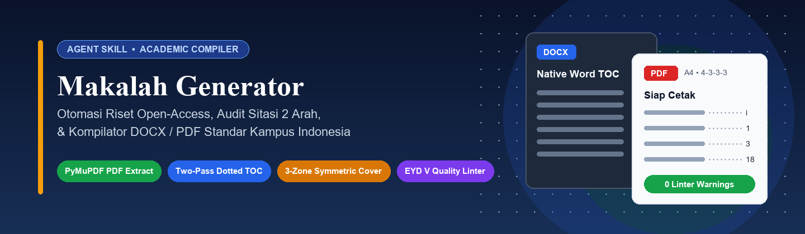
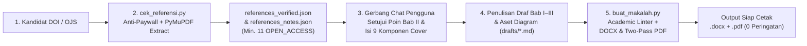
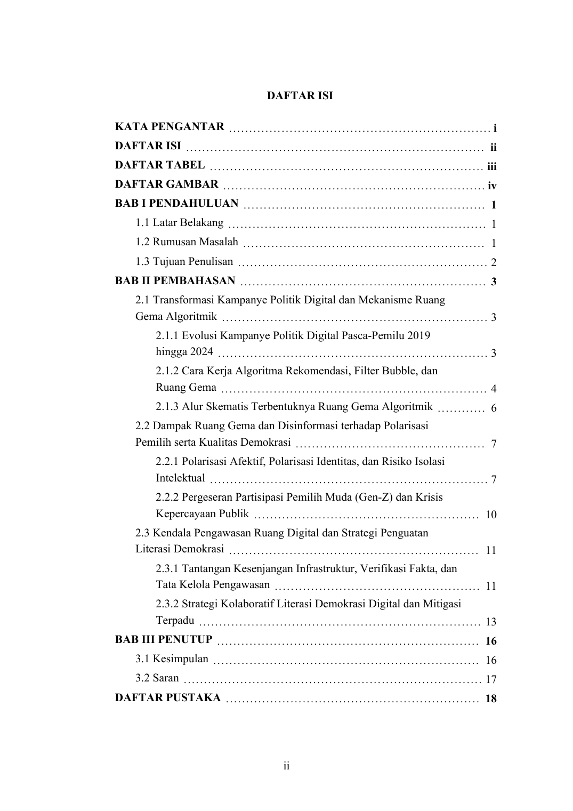
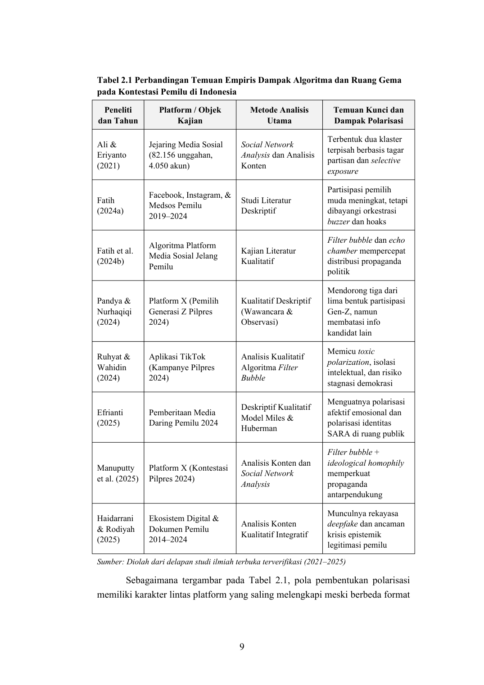

<div align="center">



<br/><br/>

[](https://www.python.org/)
[-1E3A8A?style=for-the-badge)](#mengapa-makalah-generator)
[](#arsitektur-alur-kerja)
[](#academic-quality-linter)
[](https://github.com/muhikram96798-cyber/Makalah-Generator/stargazers)

<h3>Otomasi Riset Jurnal Open-Access, Audit Sitasi Dua Arah, & Kompilator Makalah Perguruan Tinggi</h3>

<p align="center">
  <a href="#mengapa-makalah-generator">Keunggulan</a> •
  <a href="#arsitektur-alur-kerja">Arsitektur</a> •
  <a href="#galeri-pratinjau-halaman">Galeri Visual</a> •
  <a href="#contoh-makalah-demo">Contoh Makalah</a> •
  <a href="#instalasi--panduan-cepat">Panduan Cepat</a> •
  <a href="#kustomisasi-konfigurasi">Konfigurasi</a>
</p>

</div>

---

> [!IMPORTANT]
> **Seluruh Contoh Menggunakan Identitas Demo (Nol-PII):** Semua atribut sampul pada folder `makalah_workspace/` (nama mahasiswa, NIM, dosen pengampu, program studi, perguruan tinggi, serta logo standar) menggunakan **data samaran** untuk demonstrasi publik yang aman.

**Makalah Generator (`penyusun-makalah`)** adalah paket *Agent Skill* dan mesin kompilator Python untuk menyusun makalah akademik berstandar perguruan tinggi Indonesia secara menyeluruh: mulai dari verifikasi jurnal bebas *paywall*, ekstraksi teks penuh PDF via `pymupdf`, gerbang persetujuan poin pembahasan & pengisian komponen sampul interaktif via chat, validasi kualitas (*Academic Quality Linter*), hingga kompilasi serentak ke **Microsoft Word (`.docx`)** dan **PDF siap cetak (`.pdf`)**.

---

## Mengapa Makalah Generator?

| Tantangan Penulisan Manual | Solusi Otomatis di `Makalah Generator` |
| :--- | :--- |
| Mengutip jurnal terkunci *paywall* atau tautan rusak | **`cek_referensi.py`** memblokir sumber `PAYWALLED`/`UNREACHABLE` dan mewajibkan **`> 10` (`minimal 11`) sumber `OPEN_ACCESS`**. |
| Pembahasan dangkal atau menyimpang dari isi jurnal asli | Ekstraksi otomatis abstrak, metode, hasil, & kesimpulan PDF via **`pymupdf`** ke `references_notes.json` sebelum menulis naskah (`Bab II >= 1.400 kata`). |
| Sampul bergeser kanan akibat margin jilid `4-3-3-3` | **Grid 3-Zona Simetris (`3-3-3-3`)** khusus sampul agar logo & teks tepat di tengah A4 serta blok institusi rapat batas bawah (`DOCX` & `PDF` presisi). |
| Daftar Isi Word kosong / nomor halaman PDF meleset | **Two-Pass Dotted Leader TOC** di PDF dan **Native Word TOC (`w:sdt` + `TOC \o "1-3"`)** lengkap dengan `auto-update fields` di DOCX. |
| Judul sub-bab menggantung (*orphan*) & sitasi lupa tercantum | **Academic Quality Linter** memeriksa sinkronisasi sitasi 2 arah (`Daftar Pustaka ↔ Teks`), membungkus `KeepTogether`, & mengunci keutuhan entri pustaka. |

---

## Arsitektur Alur Kerja



---

## Galeri Pratinjau Halaman

Berikut tangkapan layar aktual (*pixel-verified*) dari hasil kompilasi PDF makalah demo:

<table>
  <tr>
    <td align="center" width="50%">
      <strong>1. Sampul Grid 3-Zona Simetris (`3-3-3-3`)</strong><br/>
      <sub>Tanpa subjudul default • Logo 5,0 cm di tengah • Blok institusi rapat margin bawah</sub><br/><br/>
      
    </td>
    <td align="center" width="50%">
      <strong>2. Daftar Isi Two-Pass Dotted Leader</strong><br/>
      <sub>Sinkron otomatis antara halaman Romawi awal (i–iv) & angka Arab (1+)</sub><br/><br/>
      
    </td>
  </tr>
  <tr>
    <td align="center" width="50%">
      <strong>3. Tabel Word Grid & Sitasi Dua Arah</strong><br/>
      <sub>Header berulang (repeatRows), anti-terbelah baris, & sitasi terverifikasi</sub><br/><br/>
      
    </td>
    <td align="center" width="50%">
      <strong>4. Integrasi Diagram Alur di Dalam Pembahasan</strong><br/>
      <sub>Aset visual resolusi tinggi disertai penomoran Gambar & sumber rujukan</sub><br/><br/>
      
    </td>
  </tr>
</table>

---

## Contoh Makalah Demo

Setiap folder di dalam `makalah_workspace/` memuat lengkap `blueprint.json`, catatan ekstraksi PDF, draf Markdown (`kata_pengantar.md`, `bab_01.md`–`bab_03.md`), aset gambar, serta hasil akhir `.pdf` dan `.docx`:

| # | Judul Makalah | Identitas Penulis & Mata Kuliah *(Demo)* | Pustaka & Linter | Tebal | Berkas Hasil |
| :---: | :--- | :--- | :---: | :---: | :---: |
| **1** | **Transformasi Kampanye Politik Digital dan Fenomena Ruang Gema (*Echo Chamber*) pada Pemilihan Umum di Indonesia** | **Andi Pratama** (`240202003`)<br/>*Ilmu Politik dan Komunikasi Digital* | `13/13 OPEN_ACCESS`<br/>`0` peringatan | `24` hal. | [PDF](makalah_workspace/kampanye-politik-digital-echo-chamber/output/TRANSFORMASI_KAMPANYE_POLITIK_DIGITAL_DAN_FENOMENA.pdf) • [DOCX](makalah_workspace/kampanye-politik-digital-echo-chamber/output/TRANSFORMASI_KAMPANYE_POLITIK_DIGITAL_DAN_FENOMENA.docx) |
| **2** | **Penerapan *Chatbot* Berbasis *Natural Language Processing* sebagai Media Layanan Informasi Akademik di Perguruan Tinggi** | **Siti Aminah** (`240101002`)<br/>*Pemrosesan Bahasa Alami* | `11/11 OPEN_ACCESS`<br/>`0` peringatan | `21` hal. | [PDF](makalah_workspace/chatbot-nlp-layanan-akademik/output/PENERAPAN_CHATBOT_BERBASIS_NATURAL_LANGUAGE_PROCES.pdf) • [DOCX](makalah_workspace/chatbot-nlp-layanan-akademik/output/PENERAPAN_CHATBOT_BERBASIS_NATURAL_LANGUAGE_PROCES.docx) |
| **3** | **Analisis Implementasi Sistem *Point of Sale* Berbasis *Cloud* dalam Meningkatkan Efisiensi Transaksi UMKM Sektor Kuliner** | **Budi Santoso** (`240101001`)<br/>*Logika Informatika* | `6` pustaka<br/>*(studi uji awal)* | `16` hal. | [PDF](makalah_workspace/analisis-pos-cloud-umkm-kuliner/output/ANALISIS_IMPLEMENTASI_SISTEM_POINT_OF_SALE_BERBASI.pdf) • [DOCX](makalah_workspace/analisis-pos-cloud-umkm-kuliner/output/ANALISIS_IMPLEMENTASI_SISTEM_POINT_OF_SALE_BERBASI.docx) |

---

## Instalasi & Panduan Cepat

### 1. Instalasi Dependensi

Pastikan **Python `3.10+`** terpasang pada sistem Anda, lalu instal pustaka berikut:

```powershell
pip install python-docx reportlab Pillow pymupdf
```

> [!TIP]
> **Memasang sebagai Agent Skill:** Salin direktori `penyusun-makalah/` ke folder skill agen Anda (misalnya `~/.gemini/config/skills/penyusun-makalah/`), lalu panggil dengan `/penyusun-makalah <topik makalah>`.

### 2. Jalankan Uji Mandiri (*Smoke Test*)

```powershell
python penyusun-makalah/scripts/cek_referensi.py --smoke-test
python penyusun-makalah/scripts/buat_makalah.py --smoke-test
```

### 3. Perintah CLI Lengkap

<details>
<summary><strong>Buka contoh skrip verifikasi referensi, ekstraksi PDF, dan kompilasi dokumen</strong></summary>

```powershell
# 1. Uji keterbukaan daftar kandidat & ekstrak isi PDF ke references_notes.json
python penyusun-makalah/scripts/cek_referensi.py `
  --input makalah_workspace/kampanye-politik-digital-echo-chamber/references_candidates.json `
  --output makalah_workspace/kampanye-politik-digital-echo-chamber/references_verified.json `
  --extract-notes makalah_workspace/kampanye-politik-digital-echo-chamber/references_notes.json

# 2. Ekstrak ulang isi PDF dari file references_verified.json yang sudah ada
python penyusun-makalah/scripts/cek_referensi.py `
  --from-verified makalah_workspace/kampanye-politik-digital-echo-chamber/references_verified.json `
  --extract-notes makalah_workspace/kampanye-politik-digital-echo-chamber/references_notes.json

# 3. Kompilasi DOCX + PDF sekaligus menjalankan Academic Quality Linter
python penyusun-makalah/scripts/buat_makalah.py `
  --workspace makalah_workspace/kampanye-politik-digital-echo-chamber `
  --output-dir makalah_workspace/kampanye-politik-digital-echo-chamber/output

# 4. Override preset margin Kiri,Atas,Kanan,Bawah via CLI (contoh: 4-4-3-3)
python penyusun-makalah/scripts/buat_makalah.py `
  --workspace makalah_workspace/kampanye-politik-digital-echo-chamber `
  --margin 4,4,3,3
```

</details>

---

## Kustomisasi Konfigurasi

<details id="academic-quality-linter">
<summary><strong>1. Daftar Aturan Validasi di Academic Quality Linter</strong></summary>

| Kode Pemeriksaan | Aturan yang Ditegakkan |
| :--- | :--- |
| `[Jumlah Referensi]` & `[Akses Referensi]` | Minimal `11` entri pada `blueprint.json` dan seluruh sumber `references_verified.json` berstatus `OPEN_ACCESS`. |
| `[Referensi Terlarang]` | Menolak domain non-ilmiah seperti `wikipedia.org`, `blogspot.com`, dan `wordpress.com`. |
| `[Sinkronisasi Sitasi]` | Wajib konsisten dua arah: setiap entri Daftar Pustaka disitasi di teks, dan tiap sitasi `(Penulis, Tahun)` terdaftar di Daftar Pustaka. |
| `[Kedalaman Pembahasan]` | Bab II minimal **`1.400` kata** dan tiap sub-bab utama (`2.1`–`2.3`) berisi minimal **`3` paragraf analitis**. |
| `[Komponen Sampul]` | Memastikan seluruh komponen cover terisi tanpa placeholder `[...]` yang tertinggal. |
| **Kepatuhan EYD V & Penutup** | Paragraf standar `3–7` kalimat, dilarang kalimat diawali digit `0–9`, butir `3.1 Kesimpulan` selaras `1-to-1` dengan `1.2 Rumusan Masalah`, serta `3.2 Saran` mencakup `3` sasaran eksplisit. |

</details>

<details>
<summary><strong>2. Contoh Struktur Minimal <code>blueprint.json</code></strong></summary>

```json
{
  "title": "JUDUL MAKALAH AKADEMIK",
  "subtitle": "",
  "course": "Nama Mata Kuliah",
  "lecturer": "Nama Dosen Pengampu + Gelar",
  "authors": [{ "name": "Nama Mahasiswa", "id": "NIM" }],
  "department": "Program Studi ...",
  "faculty": "Fakultas ...",
  "institution": "Universitas Nusantara",
  "city": "Jakarta",
  "year": "2026",
  "academic_year": "2025/2026",
  "logo_path": "assets/logo_kampus.png",
  "margin_preset": "4-3-3-3",
  "preface_date": "Jakarta, November 2026",
  "problem_statements": ["Rumusan 1?", "Rumusan 2?", "Rumusan 3?"],
  "references": ["Penulis, A. (2025). Judul artikel. *Nama Jurnal*, 1(1), 1-10. https://doi.org/..."]
}
```

</details>

---

## Struktur Repositori

```text
Makalah-Generator/
├── README.md                                  # Dokumentasi proyek & showcase visual
├── .gitignore
├── docs/                                      # Aset banner & pratinjau visual README
│   ├── hero_banner.png
│   ├── preview_cover_demo.png
│   ├── preview_toc_demo.png
│   ├── preview_table_demo.png
│   └── preview_diagram_demo.png
├── penyusun-makalah/                          # Paket inti Agent Skill
│   ├── SKILL.md                               # Alur kerja agen & gerbang konfirmasi cover
│   ├── references/
│   │   ├── schema-blueprint.md                # Skema JSON & konvensi Markdown
│   │   └── standar-akademik.md                # Pedoman EYD V, sitasi, & tata letak A4
│   └── scripts/
│       ├── cek_referensi.py                   # Verifikator open-access & ekstraktor PDF
│       └── buat_makalah.py                    # Kompilator DOCX/PDF & Academic Linter
└── makalah_workspace/                         # 3 Workspace Contoh Makalah Demo
    ├── analisis-pos-cloud-umkm-kuliner/
    ├── chatbot-nlp-layanan-akademik/
    └── kampanye-politik-digital-echo-chamber/
```
