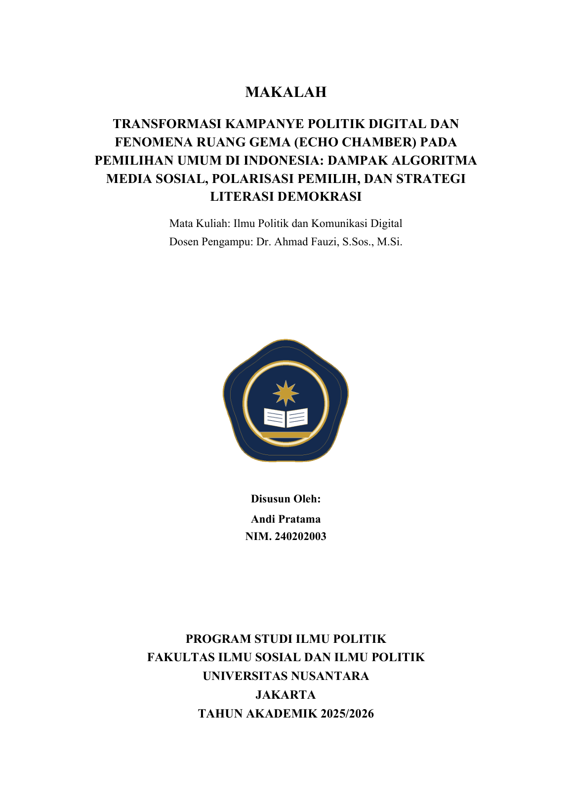

# Penyusun Makalah Akademik Standar (`penyusun-makalah`)

Skill Agent dan kompilator otomatis berbasis Python untuk meriset jurnal ilmiah *open-access*, mengekstrak isi PDF, menyusun kerangka pembahasan yang mudah dipahami, memvalidasi kualitas naskah dengan *Academic Quality Linter*, serta mengompilasi makalah perguruan tinggi siap cetak ke format **DOCX (Native Word TOC)** dan **PDF (Two-Pass Dotted TOC)** berstandar Indonesia.

---

## Fitur Utama

1. **Verifikasi Keterbukaan Jurnal & Anti-Paywall (`cek_referensi.py`)**:
   - Menguji DOI/URL kandidat dan menolak sumber berbayar (`PAYWALLED`/`UNREACHABLE`) hingga terkumpul **di atas 10 sumber (`minimal 11` referensi `OPEN_ACCESS`)**.
   - Mengekstrak bagian abstrak, metode, hasil pengujian, serta kesimpulan PDF/HTML menggunakan **`pymupdf`** ke dalam `references_notes.json` sebagai landasan fakta agar penulisan naskah 100% setia pada jurnal asli.
2. **Tata Letak Baku Perguruan Tinggi (`buat_makalah.py`)**:
   - Kertas **A4**, margin isi **`4-3-3-3` cm**, font **Times New Roman 12 pt**, spasi **`1,5`**, serta **Grid 3-Zona Sampul Simetris (`3-3-3-3`)** tanpa subjudul default agar sampul `.docx` dan `.pdf` identik dan proporsional.
   - Penomoran halaman Romawi kecil (`i`, `ii`, `iii`, ...) pada bagian awal dan angka Arab (`1`, `2`, `3`, ...) dimulai dari `1` di **bawah tengah** pada isi makalah.
   - Daftar Isi, Daftar Tabel, dan Daftar Gambar otomatis: **Native Word Field (`w:sdt` + `TOC \o "1-3"`)** pada DOCX dan **Two-Pass Dotted Leader** pada PDF.
3. **Academic Quality Linter Dua Arah**:
   - Memeriksa sinkronisasi sitasi dua arah (**Daftar Pustaka $\leftrightarrow$ Teks**), kedalaman Bab II ($\ge 1.400$ kata & $\ge 3$ paragraf per sub-bab utama), larangan kalimat berawalan angka (EYD V), kelengkapan *placeholder* sampul, panjang paragraf (`3–7` kalimat), hingga target saran tiga pihak.
   - Mencegah judul sub-bab menggantung (*orphan heading*) di PDF maupun entri Daftar Pustaka yang terbelah lintas halaman.

---

## Pratinjau Visual Sampul & Diagram

> *Catatan: Seluruh contoh makalah di repositori ini menggunakan **identitas samaran (demo)** dan logo standar generik untuk keperluan demonstrasi publik.*

| Sampul 3-Zona Simetris (PDF & DOCX) | Contoh Diagram Alur Pembahasan (`Gambar 2.1`) |
| :---: | :---: |
|  |  |

---

## Daftar Contoh Makalah Final (Demo)

| # | Judul Makalah | Penulis & Mata Kuliah (Demo) | Pustaka `OPEN_ACCESS` | Berkas Hasil |
| :---: | :--- | :--- | :---: | :--- |
| **1** | **Transformasi Kampanye Politik Digital dan Fenomena Ruang Gema (*Echo Chamber*) pada Pemilihan Umum di Indonesia** | Andi Pratama (`240202003`) — *Ilmu Politik dan Komunikasi Digital* | **`13/13`** (`0` peringatan) | [PDF](makalah_workspace/kampanye-politik-digital-echo-chamber/output/TRANSFORMASI_KAMPANYE_POLITIK_DIGITAL_DAN_FENOMENA.pdf) • [DOCX](makalah_workspace/kampanye-politik-digital-echo-chamber/output/TRANSFORMASI_KAMPANYE_POLITIK_DIGITAL_DAN_FENOMENA.docx) |
| **2** | **Penerapan *Chatbot* Berbasis *Natural Language Processing* sebagai Media Layanan Informasi Akademik di Perguruan Tinggi** | Siti Aminah (`240101002`) — *Pemrosesan Bahasa Alami* | **`11/11`** (`0` peringatan) | [PDF](makalah_workspace/chatbot-nlp-layanan-akademik/output/PENERAPAN_CHATBOT_BERBASIS_NATURAL_LANGUAGE_PROCES.pdf) • [DOCX](makalah_workspace/chatbot-nlp-layanan-akademik/output/PENERAPAN_CHATBOT_BERBASIS_NATURAL_LANGUAGE_PROCES.docx) |
| **3** | **Analisis Implementasi Sistem *Point of Sale* Berbasis *Cloud* dalam Meningkatkan Efisiensi Transaksi dan Akurasi Pencatatan Keuangan pada UMKM Sektor Kuliner** | Budi Santoso (`240101001`) — *Logika Informatika* | `6` *(makalah uji awal pra-aturan `>10`)* | [PDF](makalah_workspace/analisis-pos-cloud-umkm-kuliner/output/ANALISIS_IMPLEMENTASI_SISTEM_POINT_OF_SALE_BERBASI.pdf) • [DOCX](makalah_workspace/analisis-pos-cloud-umkm-kuliner/output/ANALISIS_IMPLEMENTASI_SISTEM_POINT_OF_SALE_BERBASI.docx) |

---

## Struktur Repositori

```text
.
├── README.md
├── docs/                                  # Aset pratinjau visual untuk README
├── penyusun-makalah/                      # Paket Skill Lengkap
│   ├── SKILL.md                           # Alur kerja agen & gerbang konfirmasi komponen sampul
│   ├── references/
│   │   ├── schema-blueprint.md            # Skema blueprint.json & aturan Markdown
│   │   └── standar-akademik.md            # Standar EYD V, sitasi, & format tata letak
│   └── scripts/
│       ├── cek_referensi.py               # Verifikator open-access & ekstraktor PDF pymupdf
│       └── buat_makalah.py                # Kompilator DOCX & PDF + Academic Quality Linter
└── makalah_workspace/                     # 3 Workspace Contoh Makalah Demo
    ├── analisis-pos-cloud-umkm-kuliner/
    ├── chatbot-nlp-layanan-akademik/
    └── kampanye-politik-digital-echo-chamber/
```

---

## Cara Menggunakan & Menguji Kompilator

Pastikan Python `3.10+` beserta paket `python-docx`, `reportlab`, `Pillow`, dan `pymupdf` telah terpasang:

```powershell
# 1. Uji mandiri skrip verifikator & kompilator (luring)
python penyusun-makalah/scripts/cek_referensi.py --smoke-test
python penyusun-makalah/scripts/buat_makalah.py --smoke-test

# 2. Verifikasi & ekstrak isi PDF jurnal dari daftar kandidat
python penyusun-makalah/scripts/cek_referensi.py `
  --input makalah_workspace/kampanye-politik-digital-echo-chamber/references_candidates.json `
  --output makalah_workspace/kampanye-politik-digital-echo-chamber/references_verified.json `
  --extract-notes makalah_workspace/kampanye-politik-digital-echo-chamber/references_notes.json

# 3. Kompilasi ulang workspace makalah menjadi DOCX & PDF
python penyusun-makalah/scripts/buat_makalah.py `
  --workspace makalah_workspace/kampanye-politik-digital-echo-chamber `
  --output-dir makalah_workspace/kampanye-politik-digital-echo-chamber/output
```
